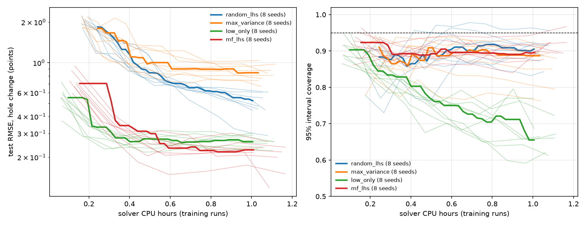

# active-multifidelity-surrogates

**Given one hour of solver time, how should you spend it to get the most accurate, best-calibrated surrogate:
on expensive accurate simulations, cheap approximate ones, or a mix, and chosen in advance or by the model?**

A follow-up to [forming-surrogates](https://github.com/usman7384/forming-surrogates), which trained a
Gaussian-process surrogate of the ring compression test on a fixed Latin hypercube of fine-mesh runs. Here the
same solver and GP are put in a loop, and sampling strategies are compared at the same solver budget (1 CPU
hour) on a held-out fine-mesh test set, over many random seeds.

## Result

One page: [media/result_overview.png](media/result_overview.png). Narrated explainers: 44 seconds
([media/explainer_short.mp4](media/explainer_short.mp4), [GIF](media/explainer_short.gif)) and 2 minutes
([media/explainer.mp4](media/explainer.mp4)); source in [media/explainer](media/explainer).




Thin lines: one seed each. Thick lines: the median over eight seeds. Test set: 100 fine-mesh runs (274 rows),
held out. Final scores, mean ± sd over seeds 1-8 ([table](results/final/summary.md),
[data](results/final/summary.json)):

| Strategy | How the next runs are chosen | CPU h | Runs (cheap / fine) | Test RMSE (points) | 95% coverage | CRPS |
|---|---|---|---|---|---|---|
| `random_lhs` | Latin hypercube, fine mesh only | 1.05 | 0 / 125 | 0.484 ± 0.097 | 0.90 ± 0.03 | 0.215 |
| `max_variance` | fine-mesh cases where the GP is most unsure | 1.07 | 0 / 110 | 0.839 ± 0.115 | 0.86 ± 0.05 | 0.409 |
| `low_only` | Latin hypercube, cheap mesh only | 1.06 | 1675 / 0 | 0.257 ± 0.026 | 0.68 ± 0.05 | 0.110 |
| **`mf_lhs`** | Latin-hypercube cheap runs plus ~30% of solver time on random fine runs; multi-fidelity GP | 1.10 | 1160 / 50 | **0.205 ± 0.044** | **0.91 ± 0.03** | **0.080** |

Paired by seed, `mf_lhs` against the others at the same solver cost (one-sided sign test; 8/8 gives
p = 0.004, 7/8 gives p = 0.035):

| Against | at 0.5 CPU h | at 0.75 CPU h | at 1.0 CPU h |
|---|---|---|---|
| `random_lhs`, lower RMSE | 8 / 8 | 8 / 8 | 8 / 8 |
| `low_only`, lower RMSE | 3 / 8 | 7 / 8 | 6 / 8 (p = 0.15) |
| `low_only`, coverage closer to 0.95 | 8 / 8 | 8 / 8 | 8 / 8 |

- **Mixing meshes beats fine runs alone, clearly.** `mf_lhs` has lower error than `random_lhs` in every seed
  at every cost, by about 2.3x at 1 CPU hour, with the same coverage. Uncertainty-driven fine sampling
  (`max_variance`) is worse than random fine sampling.
- **Cheap runs alone become confidently wrong.** `low_only` stalls near RMSE 0.26 from 0.5 to 1 CPU hour while
  its coverage falls to 0.68: more cheap data makes the GP surer of the coarse mesh's answer, not the fine one.
  `mf_lhs` keeps coverage near 0.90 in every seed.
- **Below 0.5 CPU hours cheap runs alone are more accurate**: `mf_lhs` pays up front for fine runs.
- **Nothing reaches 95% coverage** on this test set; the best strategies sit near 0.90.

### Pre-registered: `mf_lhs` against `low_only`, seeds 9-20

Hypothesis, test and seeds were committed before the runs ([PREREGISTRATION.md](PREREGISTRATION.md), part 1):
one-sided Wilcoxon signed-rank on d = RMSE(`low_only`) − RMSE(`mf_lhs`) at 1.0 CPU hour, twelve fresh seeds,
α = 0.05 ([confirm.md](results/confirm/confirm.md), [data](results/confirm/confirm.json)).

| at 1.0 CPU h, seeds 9-20 | `low_only` | `mf_lhs` |
|---|---|---|
| Test RMSE, mean | 0.251 | 0.178 |
| 95% coverage, mean | 0.67 | 0.94 |

**Supported, p = 0.0005.** `mf_lhs` has lower RMSE in 11 of 12 seeds (sign test p = 0.003); mean relative
gain 29.5%, median 34.7%. At 0.75 CPU h the gain also holds (p = 0.026). Coverage is closer to 0.95 in 12 of
12 seeds. The gain was 12% on seeds 1-8 and 30% on seeds 9-20, so treat it as roughly 10-35%.

### Exploratory: integrated variance reduction (`mf_ivr`), seeds 1-8

`mf_ivr` lets the model choose both the case and the mesh of every run (see The strategies). Not
pre-registered, and run on the same seeds as the main table ([summary](results/ivr_compare/summary.md)).

| at 1.0 CPU h, seeds 1-8 | `low_only` | `mf_lhs` | `mf_ivr` |
|---|---|---|---|
| Test RMSE, mean ± sd | 0.260 ± 0.024 | 0.230 ± 0.035 | 0.209 ± 0.052 |
| 95% coverage, final mean | 0.68 | 0.91 | 0.88 |
| Fine runs, final mean | 0 | 50 | 38 (19-69) |

- Against `mf_lhs`: no clear difference. Lower RMSE in 5 of 8 seeds at 1 h, better on average before 0.5 h
  (it does not buy fine runs before they pay), worse coverage (`mf_lhs` closer to 0.95 in 7 of 8).
- Against `low_only`: lower RMSE in 7 of 8 seeds at 0.75 and 1 h, coverage closer to 0.95 in 8 of 8.
- The number of fine runs it buys (19-69 by seed) drives its result: the three seeds with 49-69 fine runs end at
  RMSE 0.12-0.15 and coverage 0.92-0.95, the five with 19-35 at 0.22-0.27 with coverage 0.79-0.91. While fine
  runs are few, the correction's own variance is poorly estimated, so the greedy rule under-buys them.

### Pre-registered: IVR with a fine-run floor against `mf_lhs`

`mf_ivr_floor` is `mf_ivr` with at least 40% of each round's CPU seconds on fine runs, placed in IVR order
([PREREGISTRATION.md](PREREGISTRATION.md), part 2; seeds 9-20, one-sided Wilcoxon at 1.0 CPU h).

| at 1.0 CPU h, seeds 9-20 | `mf_lhs` | `mf_ivr_floor` |
|---|---|---|
| Test RMSE, mean | 0.178 | 0.229 |
| 95% coverage, mean | 0.94 | 0.91 |
| Fine runs bought, mean (range) | 50 | 70 (54-90) |

**Not supported: p = 0.99.** `mf_ivr_floor` has lower RMSE in only 2 of 12 seeds; its error is 40% higher on
average ([confirm.md](results/confirm_ivr/confirm.md), [data](results/confirm_ivr/confirm.json)). The floor did
what it was meant to (every seed bought 54-90 fine runs, against 19-69 without it), and it did not help: buying
enough fine runs was not the problem, where IVR puts them is. Against `low_only` on the same seeds it is lower
in 8 of 12 (not significant) and closer to 0.95 coverage in 12 of 12. On this problem a fixed, evenly spread
design beats the model choosing its own runs; `mf_lhs` stays the recommended default.

## The strategies

All start from the same initial design (60 cheap and 10 fine Latin-hypercube runs) and refit the GP after every
batch until the budget is spent. The model takes part in choosing the data only in the active-learning ones.

| Strategy | Mesh | How the next runs are chosen | Active learning |
|---|---|---|---|
| `random_lhs` | fine | a fresh Latin hypercube each round: evenly spread, fixed in advance | no |
| `low_only` | cheap | the same, cheap mesh | no |
| `max_variance` | fine | from a Sobol candidate pool, the cases where the GP's predictive sd is largest, with a minimum spacing | yes |
| `mf_lhs` | both | a Latin-hypercube cheap batch, plus fine runs on a random 30%-of-cost subset of it (nested) | no |
| `mf_ivr` | both | integrated variance reduction: the (case, mesh) that removes the most predictive variance over a fixed reference set per CPU second, greedily with exact covariance downdates; a fine pick also gets the cheap run | yes |
| `mf_ivr_floor` | both | `mf_ivr` with at least 40% of each round's CPU seconds on fine runs | yes |

## How it works

```
initial LHS runs -> fit GP -> score on test set -> strategy proposes a batch -> solve -> refit -> ...
                                                                    until the solver budget is spent
```

- **Oracle** (`amfs/oracle.py`): the ring solver behind a cache. Every call names a fidelity (a mesh level)
  and every result keeps the CPU time of its original solve, so budgets are counted in solver CPU seconds and
  stay identical when a run is read back from the cache. Cache writes are atomic, so parallel experiments share
  one cache.
- **Data** (`amfs/design_space.py`): a case is (od_id, h_id, mf, m) in the forming-surrogates training box.
  Each run is pressed to 30.5% and read at 10, 20 and 30%, giving up to three rows of
  (od_id, h_id, mf, m, reduction) -> inner-diameter change. Runs that stop early (fold-over at high friction)
  give fewer rows.
- **Models** (`amfs/models.py`): the forming-surrogates GP (Matérn 5/2, ARD, exact). Above 1,000 rows its
  hyper-parameters are fitted on a random 1,000-row subsample and the posterior is conditioned on every row.
  The multi-fidelity GP is autoregressive, f_high = rho · f_low + delta: a GP on all cheap rows plus a
  correction delta fitted to the fine rows' residuals, with rho = 1. delta is chosen every round by 5-fold
  cross-validation over the fine runs: a robust straight line in friction and reduction, or a GP on all five
  inputs (the line while fine runs are few, the GP from about 30-60 fine runs).
- **Acquisition** (`amfs/ivr.py`): a GP's posterior covariance does not depend on the observed values, so the
  variance a run would remove everywhere is known before it is solved; `GreedyIVR` scores candidates and
  downdates the covariance after each pick.
- **Scores** (`amfs/metrics.py`): RMSE, 95% coverage, CRPS and mean predictive sd on the fixed fine-mesh test
  set (its own seed; not charged to any budget).

## The fidelity pair

`scripts/fidelity_study.py` ran two rings at six frictions on eight numerics levels against nz = 16
([results](results/fidelity/fidelity_study.json), [figure](results/fidelity/fidelity_study.png)):

| Level | Seconds per run | RMSE vs nz16 (all) | RMSE at mf >= 0.6 | Runs stopped early (of 12) |
|---|---|---|---|---|
| **cheap: nz = 4, dh_frac = 0.04** | 2.3 | 0.105 | 0.165 | 1 |
| nz = 4 | 12.6 | 0.096 | 0.152 | 1 |
| nz = 8 | 24.0 | 0.020 | 0.026 | 3 |
| **fine: nz = 12** | 27.1 | 0.013 | 0.013 | 4 |
| nz = 16 (reference) | 70.9 | 0 | 0 | 5 |

The time step, not the mesh, is the cheap lever: 4x larger steps cut the coarse run from 12.6 s to 2.3 s for
almost no extra error. In the sweeps, on CPU time, a cheap run costs about 2 s and a fine run about 34 s. The
coarse-minus-fine gap is small at low friction and on thin rings, and reaches 1-2 points on thick rings near
fold-over at 30% reduction.

## Reproduce

```bash
python -m venv .venv && source .venv/bin/activate      # Windows: .venv\Scripts\activate
pip install -r requirements.txt
python -m pytest -q                                      # about 1 minute, includes tiny experiments
python scripts/run.py configs/mf_lhs.yaml --seed 1       # one experiment, about 15-20 minutes on 4 workers
python scripts/sweep.py --configs random_lhs max_variance low_only mf_lhs --seeds 1 2 3 4 5 6 7 8 \
    --parallel 2 --out results/final                     # about 4 hours on 8 cores
python scripts/summarize.py results/final                # figure, table, paired tests
python scripts/sweep.py --configs low_only mf_lhs --seeds 9 10 11 12 13 14 15 16 17 18 19 20 \
    --parallel 2 --out results/confirm && python scripts/confirm.py results/confirm
python scripts/sweep.py --configs mf_ivr_floor --seeds 9 10 11 12 13 14 15 16 17 18 19 20 \
    --parallel 2 --out results/confirm_ivr && python scripts/confirm.py results/confirm_ivr --a mf_lhs --b mf_ivr_floor
```

The sweep is resumable (a finished strategy and seed is skipped), and seeds draw separate Latin hypercubes
(`seed * 1000 + round`).

## Caveats

- **One problem, one solver.** Every number is for the ring test on this solver and this mesh pair. The fine
  mesh is the reference, not the truth (it is within 0.013 points of nz = 16).
- **Coverage is below 0.95 for every strategy** (0.94 at best), so no interval here is fully calibrated.
- **The fine-run share (30%, floor 40%) and the batch sizes were not tuned.** CPU time was measured with two
  experiments sharing the machine, which inflates every strategy's cost similarly but not exactly.

## Next steps

1. Why IVR's fine runs teach a worse correction than random ones: compare the fine-minus-cheap residuals of the
   cases each picks. The likely cause is that the model's most uncertain cases are the hardest ones, so the
   correction learns an unrepresentative offset.
2. Tune the fine-run share on a validation set, and calibrate the intervals.
3. A decision-aware acquisition that targets rings near the spec boundary, where go/check/stop verdicts flip.

## Provenance and licence

`ringsim/solver.py`, `amfs/gp.py` and `amfs/calibration.py` are copied unchanged from forming-surrogates
(commit `3a0bc31`); each file says so in its first line. `amfs/oracle.py` is adapted from its
`surrogates/gp_bo/solver_calls.py`. The solver is verified, not validated: see the forming-surrogates README.
MIT licence.
