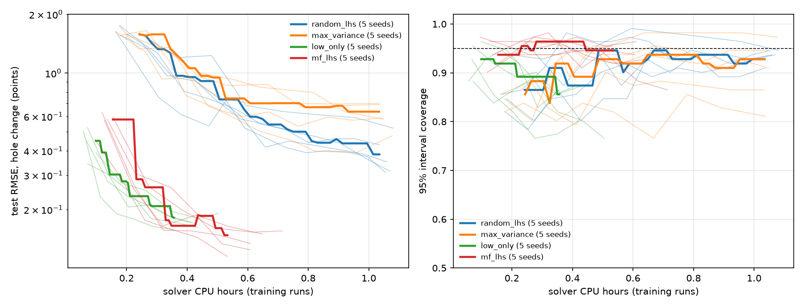

# active-multifidelity-surrogates

**How many solver runs does a calibrated surrogate actually need, and how much can you save by choosing them
well and mixing cheap and expensive meshes?**

A small, focused follow-up to [forming-surrogates](https://github.com/usman7384/forming-surrogates). That
project trained a Gaussian-process surrogate of the ring compression test on 460 solver runs from a fixed
Latin hypercube. Here the same solver and the same GP are put in a loop, and four ways of spending a solver
budget are compared on one fixed fine-mesh test set, over five seeds each.

## Result



Thin lines: one seed each. Thick lines: the median over the five seeds, drawn only over the cost range every
seed reached. Final scores, mean ± sd over 5 seeds ([table](results/sweep/summary.md),
[data](results/sweep/summary.json)):

| Strategy | How the next runs are chosen | Final CPU h | Runs (cheap / fine) | Test RMSE (points) | 95% coverage | CRPS |
|---|---|---|---|---|---|---|
| `random_lhs` | more Latin-hypercube cases, fine mesh (the forming-surrogates approach) | 1.06 | 0 / 124 | 0.386 ± 0.081 | 0.94 ± 0.01 | 0.180 |
| `max_variance` | fine-mesh cases where the current GP is most unsure | 1.05 | 0 / 106 | 0.608 ± 0.082 | 0.90 ± 0.06 | 0.313 |
| `low_only` | more Latin-hypercube cases, cheap mesh only | 0.43 | 600 / 0 | 0.171 ± 0.011 | 0.84 ± 0.04 | 0.091 |
| **`mf_lhs`** | cheap Latin-hypercube cases plus ~30% of solver time on random fine cases; multi-fidelity GP | 0.62 | 560 / 28 | **0.136 ± 0.015** | **0.93 ± 0.04** | **0.068** |

What it shows:

- **Mixing meshes wins, on accuracy and on honesty.** `mf_lhs` has the lowest error and the best CRPS, and beats
  `low_only` on both error and coverage in each of the five paired seeds. Against the forming-surrogates approach
  (`random_lhs`) it is 2.8x more accurate for 59% of the solver time.
- **Cheap runs alone are fast but overconfident.** `low_only` is the cheapest route to a decent error and ties
  `mf_lhs` on error at equal cost (about 0.17 at 0.43 CPU h). But its intervals cover the fine-mesh truth only
  84% of the time, and it stalls near the coarse mesh's bias: in the pilot the coarse-minus-fine bias at the test
  cases was 0.14 points rms, which no number of cheap runs removes. `mf_lhs` keeps improving past that.
- **Uncertainty-driven sampling lost, twice.** `max_variance` is worse than random fine-mesh sampling (0.61
  against 0.39). A GP is most unsure at the edges of the box, so variance-driven picks pile up there, where
  runs are expensive and fold over; that was measured for the first multi-fidelity strategy, which also chose
  by variance and lost to cheap runs alone (below), and is the likely cause here too.
- **Calibration is the reason to pay for fine runs.** About 28 fine runs (30% of the solver time) are enough to
  learn the coarse mesh's bias, as a straight line in friction and reduction, and pull coverage from 0.84 to 0.93.

## How it works

```
initial LHS runs -> fit GP -> score on test set -> strategy proposes a batch -> solve -> refit -> ...
                                                     until the solver budget or the round cap is reached
```

- **Oracle** (`amfs/oracle.py`): the ring solver behind a cache. Every call names a fidelity (a mesh
  resolution) and every result keeps the CPU time of its original solve, so budgets are counted in real solver
  CPU seconds and stay identical when a run is read back from the cache. CPU time, not wall time: wall time was
  inflated by other jobs on the machine during the pilot. Cache writes are atomic, so parallel experiments share
  one cache.
- **Data** (`amfs/design_space.py`): a case is (od_id, h_id, mf, m) in the forming-surrogates training box. Each
  run is pressed to 30.5% and read at 10, 20 and 30%, giving up to three rows of (od_id, h_id, mf, m, reduction)
  -> inner-diameter change. Runs that stop early (fold-over at high friction) give fewer rows.
- **Models** (`amfs/models.py`): the forming-surrogates GP (Matérn 5/2, ARD, GPyTorch fit with exact Cholesky,
  numpy serving) on one fidelity's rows; and the autoregressive multi-fidelity GP, f_high = rho * f_low + delta:
  a GP on all cheap rows, and a correction delta fitted on the fine rows' residuals. `mf_lhs` uses rho = 1 and
  a linear delta in friction and reduction, fitted with Huber weights (see the pilot below).
- **Scores** (`amfs/metrics.py`): RMSE, 95% coverage, CRPS and mean predictive sd on a fixed fine-mesh test set
  of 40 runs (111 rows; its own seed; not charged to any budget).

## The fidelity pair

`scripts/fidelity_study.py` ran two rings at six frictions on eight numerics levels against nz = 16
([results](results/fidelity/fidelity_study.json), [figure](results/fidelity/fidelity_study.png)):

| Level | Seconds per run | RMSE vs nz16 (all) | RMSE at mf >= 0.6 | Runs stopped early (of 12) |
|---|---|---|---|---|
| **cheap: nz = 4, dh_frac = 0.04** | 2.3 | 0.105 | 0.165 | 1 |
| nz = 4 | 12.6 | 0.096 | 0.152 | 1 |
| nz = 8 | 24.0 | 0.020 | 0.026 | 3 |
| **fine: nz = 12** | 27.1 | 0.013 | 0.013 | 4 |
| nz = 16 (reference) | 70.9 | 0 | 0 | 5 |

The time step, not the mesh, is the cheap lever: 4x larger steps cut the coarse run from 12.6 s to 2.3 s for
almost no extra error. In the sweep, on CPU time, a cheap run costs about 2 s and a fine run about 34 s. The
coarse error is systematic: near zero at low friction and a growing over-prediction of the shrink at high
friction, the kind of bias a correction can learn.

## How mf_lhs came about (the pilot)

The multi-fidelity strategy took three iterations on seed 0, each diagnosed offline on cached runs without new
solves. The record is in [results/pilot](results/pilot) and [correction_study.md](results/pilot/correction_study.md).

1. **`multi_fidelity`** (first version, `configs/multi_fidelity.yaml`, pilot only): choose case and mesh by
   predictive variance removed per solver second. It lost to cheap runs alone (RMSE 0.25 against 0.16). 82% of
   its cheap runs landed within 10% of a box edge (58% for a Latin hypercube), and it never judged a fine run
   worth its cost.
2. **`mf_lhs` with variance-picked fine runs and a GP correction**: still worse than cheap runs alone. The
   correction was twice the size of the real coarse-minus-fine gap. Variance put the fine runs in the hardest
   cases, where the residual is 0.43 points rms against 0.19 at random cases, so the correction learned an
   unrepresentative bias. Trained on random fine runs instead, a linear correction in friction and reduction
   reached RMSE about 0.13 with coverage about 0.98 offline. A GP correction on all five inputs needed about 70
   fine runs to compete.
3. **`mf_lhs` with random fine runs and a least-squares linear correction**: good until one fine run with a
   2.6-point residual (a thick ring near fold-over at 30% reduction) tilted the line. A Huber fit and a
   MAD-based interval width took seed 0 from 0.236 to 0.115 at coverage 0.95. That is the version in the sweep.

## Run

```bash
python -m venv .venv && source .venv/bin/activate      # Windows: .venv\Scripts\activate
pip install -r requirements.txt
python -m pytest -q                                      # about 1 minute, includes three tiny experiments
python scripts/run.py configs/mf_lhs.yaml --seed 0       # one experiment, about 15 minutes on 4 workers
python scripts/sweep.py --configs random_lhs max_variance low_only mf_lhs --seeds 0 1 2 3 4 --parallel 2
python scripts/summarize.py results/sweep                # figure and table (sweep.py also runs it after each job)
```

The full sweep took about 3.3 hours on a 16-thread laptop, two experiments at a time. It is resumable: a
finished (strategy, seed) result is skipped. Seeds draw separate Latin hypercubes (`seed * 1000 + round`).

## Caveats

- **One problem, one solver.** Every number here is for the ring test on this solver and this mesh pair. The
  fine mesh is the reference, not the truth (it is within 0.013 points of nz = 16).
- **Unequal final costs.** `low_only` and `mf_lhs` stop at a 6-round cap (exact-GP refits grow steeply past
  about 600 cheap runs), well before the 3,600 s budget; the fine-mesh strategies run to the budget. Compare
  along the cost axis, not by the final row alone.
- **The design was tuned on seed 0.** The three fixes above were chosen by looking at seed 0's test error, so
  seed 0 is not independent evidence. Seeds 1-4 are, and `mf_lhs` beats `low_only` on error and coverage in all
  four.
- **40 test runs.** Coverage is measured on 111 rows, so a single coverage figure has a sampling sd of about
  0.025.
- **CPU time** was measured with two experiments sharing the machine; that inflates every strategy's cost
  similarly but not exactly.

## Next steps

1. Lift the round cap with a sparse or warm-started GP, to show where `low_only` stalls and how far `mf_lhs`
   keeps falling.
2. Tune the fine-run share (`high_share`): 30% was a first guess.
3. A decision-aware acquisition that targets rings near the spec boundary, where go/check/stop verdicts flip.
4. Check coverage by region (high friction, near fold-over), not only overall.

## Provenance

`ringsim/solver.py`, `amfs/gp.py` and `amfs/calibration.py` are copied unchanged from forming-surrogates
(commit `3a0bc31`); each file says so in its first line. `amfs/oracle.py` is adapted from
`surrogates/gp_bo/solver_calls.py`. Everything else is new. The solver is verified, not validated: see the
forming-surrogates README for what that means and what it does not cover.
